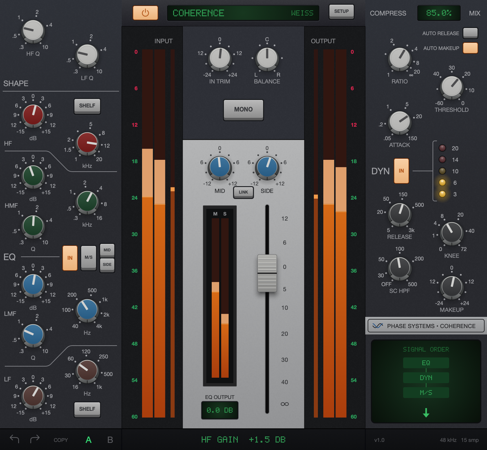

# COHERENCE, by Phase Systems

A console channel strip plug-in for mixing and mastering on macOS: a four-band EQ with independent Mid/Side settings, one compressor, a Mid/Side level stage, and input and output with metering. Free and open source (GNU AGPLv3). Made for Ableton Live 12, and controllable from an SSL UC1 and UF1 through SSL 360 Link.



*The panel in its Classic theme, rendered from the plug-in's own drawing code (control values are placeholders).*

This is **v0.6.2**. `CHANGELOG.md` lists what changed in each version. (The internal design notes it and the source comments refer to as `DESIGN.md` aren't part of the public repository.)

## Features

- **Four-band EQ** (HF, HMF, LMF, LF) with bell, shelf and cut types on HF and LF, and independent **Mid/Side** EQs.
- **Two EQ modes:** COHERENCE (zero latency, matched to analog filter shapes) and WEISS (bands at twice the sample rate, modelled on measurements of the Weiss EQ MP plug-in; 15 samples of latency, compensated by the host).
- **One clean compressor** with AUTO release, a conservative AUTO makeup, sidechain high-pass, knee and MIX, before or after the EQ.
- **Mid/Side level, balance, EQ output trim, output fader, mono monitor**, and input/output and gain-reduction meters.
- **A/B** settings slots, panel **undo/redo**, typed values, three **themes**, resizable window (60–200 %).
- **Gain stepping** (0.1, 0.5 or 0.01 dB) on every gain control, including values from automation and control surfaces.
- **SSL UC1 / UF1** control through SSL 360 Link (a profile is included).
- 64-bit processing; no lookahead, saturation or external sidechain.

## Requirements and formats

| | |
|---|---|
| macOS | 11 or later; Apple Silicon or Intel (one universal binary) |
| Formats | Audio Unit (AU) and VST3, mono and stereo. No AAX, no Windows or Linux builds |
| Tested with | Ableton Live 12 on macOS 26 (Apple Silicon), an SSL UC1 and UF1 with SSL 360 Link 1.4.8 |
| Not yet tested | Other hosts, an Intel Mac (the Intel build passes the test suite under Rosetta) |

## Install

Download `COHERENCE-0.6.2.pkg` from the Releases page and follow **[INSTALL.md](INSTALL.md)**. The installer isn't signed by Apple, so macOS asks you to approve it once; INSTALL.md shows how, and how to uninstall.

It installs the AU in `/Library/Audio/Plug-Ins/Components`, the VST3 in `/Library/Audio/Plug-Ins/VST3`, and optionally the SSL 360 Link profile for the UC1 and UF1.

### Build it yourself

You need Apple's Command Line Tools (`xcode-select --install`) and CMake 3.22 or later.

- `bash build.sh` builds the AU and VST3 for your Mac, installs them (the AU in `~/Library/Audio/Plug-Ins/Components`, the VST3 in `/Library/Audio/Plug-Ins/VST3`), installs the 360 Link profile if SSL 360 Link is present, then runs Apple's `auval` and a comparison of the AU against the VST3. It keeps the build it replaces in an `Installed builds` folder next to the source folder.
- `bash Tools/package/make_pkg.sh` builds the universal plug-ins, runs the test suite on Apple Silicon and, through Rosetta, on Intel, and makes the installer package in `dist/`.
- The test suite: `cmake -S . -B build -DCMAKE_BUILD_TYPE=Release -DCOHERENCE_BUILD_TESTS=ON`, `cmake --build build --target CoherenceTests`, then run `build/CoherenceTests_artefacts/Release/CoherenceTests`.

Use one way or the other: `build.sh` and the package put the AU in different folders.

## Project structure

| Path | What |
|---|---|
| `Source/dsp/` | All audio processing, in plain C++ (no JUCE): `Engine.*` (signal chain, compressor), `EqDesign.*` (filter design for both EQ modes), generated tables `EqFitTable.h` and `CompKneeTable.h` |
| `Source/` | Plug-in shell: parameters (`Parameters.*`), state and A/B (`PluginProcessor.*`), user preferences, the UC1 focus parameters (`EqFocus.*`) |
| `Source/gui/` | The panel, controls, meters and themes |
| `Tests/` | The headless test suite (`HeadlessTest.cpp`) and the AU/VST3 consistency check (`FormatCheck.cpp`) |
| `Tools/` | Analysis and design scripts (Python, needs numpy and scipy), the headless host `plughost`, the GUI preview renderer, the 360 Link profile generator (`ssl360link`) and the packaging scripts (`package`) |
| `deps/JUCE` | JUCE 9.0.4, vendored unmodified |
| `Assets/Fonts`, `licenses/` | The Inter typeface and third-party licences |
| `references-coh-normal.*.sha256` | Checksums of the COHERENCE-mode reference renders, the EQ's bit-exact regression test |

## Contributing

See `CONTRIBUTING.md`. Bug reports are welcome. The sound is deliberately frozen: changes to the DSP need measurements that show a real problem.


## The panel

| Area | Controls |
|---|---|
| **Left: EQ** | HF, HMF, LMF and LF, each with gain, frequency and Q. HF and LF have one key that cycles BELL, SHELF and CUT. EQ IN. **M/S** switches between a stereo EQ and independent Mid and Side EQs, and **MID / SIDE** selects which of the two the controls show. |
| **Centre** | Input and output meters, IN TRIM, MID and SIDE level with LINK, BALANCE, MONO, EQ OUTPUT and the OUTPUT fader. |
| **Right: compressor** | THRESHOLD, RATIO, ATTACK, RELEASE (with AUTO), DYN IN, the gain reduction meter, KNEE, MAKEUP (with AUTO), SC HPF and MIX, and the signal order (EQ before or after the compressor). |
| **Bottom bar** | UNDO and REDO, A/B with COPY, the display, the sample rate, the latency and the version. |
| **Header** | Power (bypasses the whole strip without clicks) and **SETUP**: EQ mode, theme, window size and gain stepping. |

### Working with the controls

- **Drag** a knob, or use the mouse wheel. The value shows in the bottom display while you hover or drag.
- **dB controls** move in 0.1 dB steps, or 0.01 dB with Shift. SETUP > Gain stepping switches to 0.5 dB or 0.01 dB. Typed values are always exact. Automation and control surfaces follow the same steps: their values play and display on the step grid, and the stored value is kept as sent.
- **Click a knob's caption** to type a value: `2.5k`, `-1.25`, `40 ms`, `1.2 s`, `4:1`. Double-click the MIX and EQ OUTPUT readouts to type.
- **Double-click or Alt-click** a control to reset it.
- **Meters:** hover a level meter for its peak, and click it to reset. Hover the gain reduction meter for its value.
- **UNDO and REDO** cover moves made on the panel. Switching A/B or loading a set starts the history again, and so does a long stretch of host automation on several parameters.
- **A/B:** B starts as a copy of A, so the first switch changes nothing. COPY copies the settings in use to the other slot. Both are saved with the set.
- **Window size:** drag the corner (60 to 200 %), or pick a size in SETUP. Each set remembers its size.
- **Themes:** Classic, Warm Graphite and Champagne, in SETUP. The choice is yours, not the set's.

## The EQ

- **EQ mode** (SETUP, saved with the set):
  - **WEISS**, the default for new instances: the bands run at twice the sample rate, modelled on measurements of Weiss EQ MP at 48 kHz, including its phase and adjustable shelf Q. It adds 15 samples of latency, which the host compensates.
  - **COHERENCE:** zero latency, matched to the analog filter shapes.
  - Switching fades for a few milliseconds. The mode isn't automatable, because it changes the latency.
- **Mid/Side:** with M/S on, Mid and Side have their own gain, frequency, Q and type on every band. Stereo and Mid share one set of settings, and Side starts flat.
- **Q** follows the classic analog definition. On shelves it shapes the knee, and on cuts it sets the resonance.
- **EQ OUTPUT** (±15 dB) matches the level after EQ moves. It sits after the compressor, so it never changes what the compressor hears, and it follows EQ IN.

## The compressor

- One clean feed-forward compressor. Its static curve, knee and timing were fitted to measurements of FabFilter Pro-C 3's Clean style. There's no external sidechain input, lookahead or output ceiling.
- **AUTO release** makes the release depend on the program.
- **AUTO makeup**, on by default, restores most of the level the compressor measurably takes away, and adds nothing while it isn't compressing. It is slow by design: after a setting changes it takes a second or two to settle. MAKEUP trims on top of it.
- **SC HPF** filters only what the detector hears. **MIX** blends the compressed and uncompressed signal.

## Signal flow

```
IN TRIM -> [ EQ -> DYN ]  or  [ DYN -> EQ ] -> MID/SIDE level -> BALANCE -> EQ OUTPUT -> OUTPUT -> (MONO monitor)
```

Processing runs at 64-bit internally. Changing the order crossfades between the two chains over 20 ms. MONO changes only what you hear: the processing and the meters keep the stereo signal.

## SSL UC1 and UF1

There's no public SDK for native UC1 support, so COHERENCE is controlled through SSL's 360 Link plug-in. The installer adds COHERENCE's 360 Link profile (`Tools/ssl360link/COHERENCE.user`). In 360 Link's Extended Functions, the Plugin On/Off, Pan, Width, Solo Safe and A/B rows are 360 Link's own, not COHERENCE's.

- The EQ knobs follow the MID / SIDE selector. E switches Stereo and M/S, and HF BELL selects Mid or Side.
- Compressor: Threshold, Ratio, Attack on the compressor knobs; Release, Knee and SC HPF on the gate knobs; Fast Attack is AUTO release and Peak is AUTO makeup. The gain reduction meter follows the compressor.
- Gate EXP switches A and B. Mix, Makeup and EQ Output are on 360 Link's Comp Mix, Gate Hold, Output Trim and Saturation Amount slots.
- Automation recorded through 360 Link on an EQ knob plays back on whichever channel (Mid or Side) is selected at the time. To automate Mid and Side separately, automate COHERENCE's own parameters.

## What is and isn't measured

- **The EQ:** COHERENCE mode is measured against the analog shapes at 44.1 to 192 kHz. WEISS mode is measured against 28 Weiss EQ MP renders at 48 kHz (`mac-results/weiss-model/weiss_compare.md`); other sample rates haven't been compared with Weiss EQ MP. The reference renders themselves aren't published.
- **The compressor** is compared with Pro-C 3 Clean on seven stems (`mac-results/v0.5.0/compare.md`).
- **Every version** runs an automated suite (`Tests/`, 271 checks and one documented limitation in 0.6.2), an Audio Unit validation and a sample-by-sample comparison of the AU against the VST3 (`Tests/FormatCheck.cpp`).
- **Tested on:** macOS 26 on Apple Silicon, with Ableton Live 12, an SSL UC1 and a UF1. The Intel build passes the test suite under Rosetta but hasn't been run on an Intel Mac.
- **Not included:** saturation or analog modelling, presets, an external sidechain, Windows or Linux builds.

## Licence

Copyright (C) 2026 Phase Systems. COHERENCE is free software under the GNU Affero General Public License, version 3 or later (`LICENSE`). It comes with no warranty. If you share a changed version, share its source under the same licence.

- JUCE 9.0.4 is used under the AGPLv3 (`licenses/JUCE-LICENSE.md`). The other third-party parts and their licences are listed in `NOTICE.md`.
- Inter typeface, SIL Open Font License 1.1 (`licenses/Inter-OFL.txt`).
- SSL, Weiss, Softube, FabFilter, Metric Halo and Harrison are named only to describe compatibility and measurements. COHERENCE is an independent project, not affiliated with or endorsed by any of them, and contains none of their code, graphics or audio. Trademarks are listed in `NOTICE.md`.
